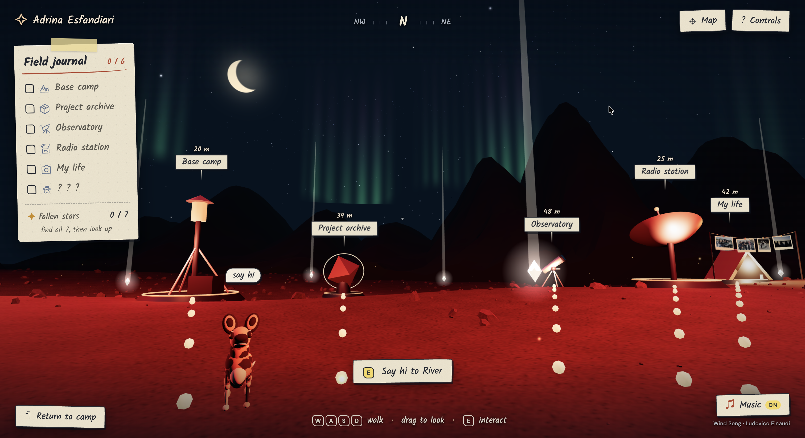

# Adrina Esfandiari — Personal Website

A personal portfolio you explore as a first-person game. Walk through a red-lit, rocky mountain landscape beneath a moving night sky, open a paper journal page at each landmark, collect fallen stars, and meet the dog who wanders the valley.



**[Open the website → adrinaesf.github.io/personal-website](https://adrinaesf.github.io/personal-website/)**

## Features

- **An explorable 3D world:** procedural mountains, textured terrain, and 1,600 instanced stones.
- **A living sky:** twinkling stars, shooting stars, a crescent moon, an aurora over the northern ridge, fireflies, and a campfire.
- **Five discoverable locations:** About me, My projects, My experience, Contact me, and My hobbies.
- **Seven fallen stars to collect:** each sends up a column of light; finding all seven lights up every star in the sky, with a meteor shower and a brighter aurora, and sends soft mist rolling across the valley floor.
- **A scrapbook interface:** journals open as paper pages with taped polaroids, and every control is a hand-drawn paper tag.
- **Game navigation:** walking, drag-to-look, illuminated paths, a compass, destination tabs, a map, and a return-to-camp control.
- **A roaming guide:** River, a small dog who introduces the world, then walks, pauses, sniffs, avoids landmarks, and catches up when the visitor moves away. Selecting him opens the story of the real dog by the river who inspired him.
- **A personal journal:** resume-backed projects and experience, plus hiking, friends, hackathons, animals, and robotics interests, with Adrina’s own photographs. Four of them also hang as polaroids on a line at the campsite.
- **Music controls:** the supplied soundtrack is enabled by default, with an Off button, quiet playback, native looping, and background pause. If the browser blocks autoplay, selecting Enter starts playback.
- **Accessible alternatives:** keyboard and touch controls, reduced-motion support, readable journals, and direct journal access through the map when WebGL is unavailable.

## Technology

Three.js renders the world and character. Plain JavaScript manages the game interface and audio; HTML and CSS render the journals. esbuild bundles the JavaScript into a static site. No backend, database, account system, or analytics is required by the application.

## Run locally

Requirements: Node.js 24 or newer, pnpm 11.25.0, and Python 3.

```sh
git clone https://github.com/Adrinaesf/personal-website.git
cd personal-website
pnpm install --frozen-lockfile
pnpm build
pnpm dev
```

Open [localhost:4173](http://localhost:4173). After changing JavaScript, run `pnpm build` again and refresh the page. The development server serves the static files without live reload.

## Controls

| Action | Control |
| --- | --- |
| Walk | W / A / S / D or arrow keys |
| Look around | Drag the landscape |
| Open a nearby landmark, or meet the dog | E or select its marker |
| Collect a fallen star | Walk into it |
| Travel to a location | Map or a journal destination tab |
| Reopen a discovered journal | Select its journal tab |
| Close a journal or menu | Escape or its close button |
| Return to the start | Return to camp |
| Toggle music | Music button |
| Disable ambient animation | Controls → Pause ambient motion |
| Walk on a touchscreen | On-screen arrow pad |

## Project structure

```text
src/
  scene.js              World geometry, walking, landmarks, navigation
  companions.js         African wild dog model and roaming behaviour
  main.js               Interface, discoveries, journals, touch controls
  music.js              Playback, looping, autoplay and visibility handling
scripts/
  build.mjs             JavaScript bundling
tests/
  companions.test.js    Dog navigation and pause regressions
  music.test.js         Autoplay and toggle-race regressions
dist/
  index.html            Authored game shell and journal content
  assets/
    style.css           Authored styling and typography
    app.js              Generated JavaScript bundle
    star.svg            Favicon
    photos/               Web-sized photographs, metadata removed
    Adrina-Esfandiari-Resume.pdf
    wind-song.mp3
docs/
  preview.jpg           Interface screenshot
.github/workflows/
  pages.yml             Publishes dist/ to GitHub Pages
```

`dist/index.html` and `dist/assets/style.css` are edited directly. The build command only regenerates `dist/assets/app.js`; it does not replace the HTML, CSS, or media. The repository includes the complete static output as well as its JavaScript source.

## Edit content and media

- **Projects, research, biography, and contact:** edit the `content-*` templates in `dist/index.html`.
- **Personal stories and photographs:** edit `content-life` and `content-wanderer`. Each photograph is a `<figure class="polaroid">`. Add images under `dist/assets/photos/` (resize them and strip location metadata first), with meaningful alt text and a caption.
- **Polaroids at the campsite:** the `campPhotos` list in `src/scene.js` names each picture and its width-to-height ratio.
- **The dog’s introduction:** the lines he says are in the Enter handler in `src/main.js`.
- **Resume:** replace `dist/assets/Adrina-Esfandiari-Resume.pdf` and update the journal content when needed.
- **Audio:** replace `dist/assets/wind-song.mp3`, then update its credit in `dist/index.html` and playback announcements in `src/music.js`.
- **Appearance:** edit `dist/assets/style.css`. Headings and controls use Kalam, journal text uses Lora, and small labels use DM Sans, with system fallbacks.

## Validation

```sh
pnpm check
pnpm test
pnpm build
```

The regression tests cover overlapping player/landmark exclusions, paused catch-up, bounded and grounded dog roaming, blocked/interrupted autoplay retry, media-error recovery, uninterrupted native looping, pending-play cancellation, rapid music toggles, and background pause. Desktop and mobile layouts and the main game interactions were also checked in a browser.

## Deployment

The site is published with GitHub Pages. Every push to `main` runs `.github/workflows/pages.yml`, which uploads the committed `dist/` directory as it is. Run `pnpm build` and commit the regenerated `dist/assets/app.js` before pushing JavaScript changes.

Any other static host also works: serve the entire `dist/` directory over HTTP or HTTPS rather than opening `index.html` directly.

## Credits and content notes

- Portfolio content and resume: Adrina Esfandiari.
- Soundtrack: **Wind Song — Ludovico Einaudi**, supplied by Adrina.
- Photographs: Adrina Esfandiari.
- The landscape, dog, destination icons, and terrain texture are generated locally from project code; there are no downloaded 3D models.
- Fonts load from Google Fonts, with local system fallbacks.
- PrintOpti’s reported prediction improvement concerns held-out slicer-generated estimates, rather than measured physical print performance.
