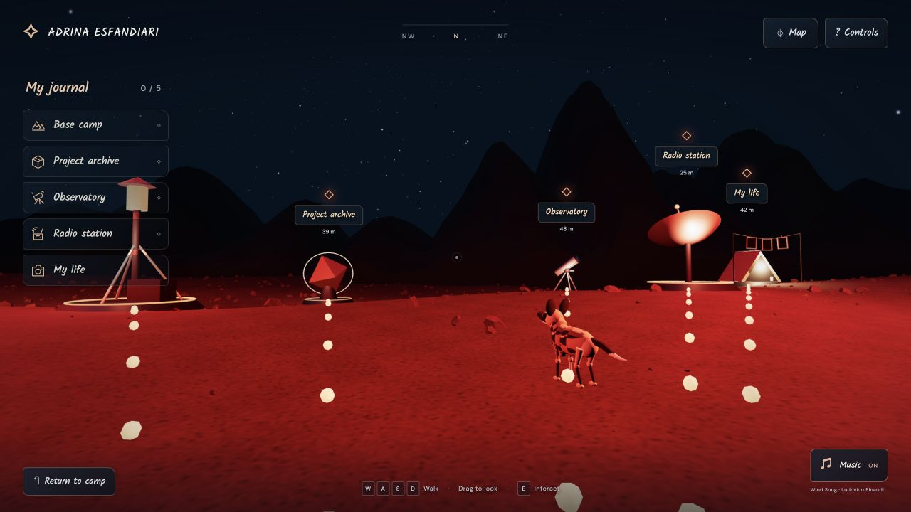

# Adrina Esfandiari — Personal Website

A personal portfolio you explore as a first-person game. Walk through a red-lit, rocky mountain landscape beneath a star-filled sky, discover Adrina’s projects and research, and visit a campsite with notes about her life and interests.



[Open the website](https://adrina-esfandiari-observatory.festivesloth3.chatgpt.site) — the current deployment is private and requires the owner’s access.

## Features

- **An explorable 3D world:** procedural mountains, a surrounding night sky, textured terrain, and 1,600 instanced stones.
- **Five discoverable locations:** Base camp, Project archive, Observatory, Radio station, and My life.
- **Game navigation:** walking, drag-to-look, illuminated paths, a compass, destination tabs, a map, and a return-to-camp control.
- **A roaming companion:** a small African wild dog that walks, pauses, sniffs, avoids landmarks, and catches up when the visitor moves away.
- **A personal journal:** resume-backed projects and experience, plus hiking, friends, hackathons, animals, and robotics interests. Photo spaces are prepared; personal photographs have not been added yet.
- **Music controls:** the supplied soundtrack is enabled by default, with an Off button, fades, looping, and background pause. If the browser blocks autoplay, selecting Enter starts playback.
- **Accessible alternatives:** keyboard and touch controls, reduced-motion support, readable journals, and direct journal access through the map when WebGL is unavailable.

## Technology

Three.js renders the world and character. Plain JavaScript manages the game interface and audio; HTML and CSS render the journals. esbuild bundles the JavaScript into a static site. No backend, database, account system, or analytics is required by the application.

## Run locally

Requirements: Node.js 24 or newer, pnpm 11.25.0, and Python 3.

```sh
git clone https://github.com/Adrinaesf/personal-website.git
cd personal-website
pnpm install --frozen-lockfile
pnpm build
pnpm dev
```

Open [localhost:4173](http://localhost:4173). After changing JavaScript, run `pnpm build` again and refresh the page. The development server serves the static files without live reload.

## Controls

| Action | Control |
| --- | --- |
| Walk | W / A / S / D or arrow keys |
| Look around | Drag the landscape |
| Inspect a nearby landmark | E or select its marker |
| Travel to a location | Map or a journal destination tab |
| Reopen a discovered journal | Select its journal tab |
| Close a journal or menu | Escape or its close button |
| Return to the start | Return to camp |
| Toggle music | Music button |
| Disable ambient animation | Controls → Pause ambient motion |
| Walk on a touchscreen | On-screen arrow pad |

## Project structure

```text
src/
  scene.js              World geometry, walking, landmarks, navigation
  companions.js         African wild dog model and roaming behaviour
  main.js               Interface, discoveries, journals, touch controls
  music.js              Playback, fades, autoplay and visibility handling
scripts/
  build.mjs             JavaScript bundling
tests/
  companions.test.js    Dog navigation and pause regressions
  music.test.js         Autoplay and toggle-race regressions
dist/
  index.html            Authored game shell and journal content
  assets/
    style.css           Authored styling and typography
    app.js              Generated JavaScript bundle
    star.svg            Favicon
    Adrina-Esfandiari-Resume.pdf
    wind-song.mp3
docs/
  preview.jpg           Interface screenshot
.openai/
  hosting.json          Existing Sites deployment configuration
```

`dist/index.html` and `dist/assets/style.css` are edited directly. The build command only regenerates `dist/assets/app.js`; it does not replace the HTML, CSS, or media. The repository includes the complete static output as well as its JavaScript source.

## Edit content and media

- **Projects, research, biography, and contact:** edit the `content-*` templates in `dist/index.html`.
- **Personal stories and photographs:** edit `content-life`. The hidden `memory-photo` figures mark places for hiking, friends, hackathon, and everyday pictures. Add images under `dist/assets/`, insert an image with meaningful alt text and an optional caption, and remove the figure’s `hidden` attribute.
- **Physical photo frames:** the campsite models are created in `src/scene.js`; they currently contain no personal photographs.
- **Resume:** replace `dist/assets/Adrina-Esfandiari-Resume.pdf` and update the journal content when needed.
- **Audio:** replace `dist/assets/wind-song.mp3`, then update its credit in `dist/index.html` and playback announcements in `src/music.js`.
- **Appearance:** edit `dist/assets/style.css`. Controls use Kalam, journal headings use Lora, and body text uses DM Sans, with system fallbacks.

## Validation

```sh
pnpm check
pnpm test
pnpm build
```

The six regression tests cover overlapping player/landmark exclusions, paused catch-up, bounded and grounded dog roaming, blocked-autoplay retry, pending-play cancellation, rapid music toggles, and background pause. Desktop and mobile layouts and the main game interactions were also checked in a browser.

## Deployment

Build the project and serve the entire `dist/` directory from a static host. Serve it over HTTP or HTTPS rather than opening `index.html` directly.

The existing private Sites deployment uses `.openai/hosting.json`, which points to `dist/`. Pushing to this GitHub repository does not automatically update that deployment. The GitHub repository and the live website have separate access settings.

## Credits and content notes

- Portfolio content and resume: Adrina Esfandiari.
- Soundtrack: **Wind Song — Ludovico Einaudi**, supplied by Adrina.
- The landscape, dog, destination icons, and terrain texture are generated locally from project code; there are no downloaded 3D models.
- Fonts load from Google Fonts, with local system fallbacks.
- PrintOpti’s reported prediction improvement concerns held-out slicer-generated estimates, rather than measured physical print performance.
